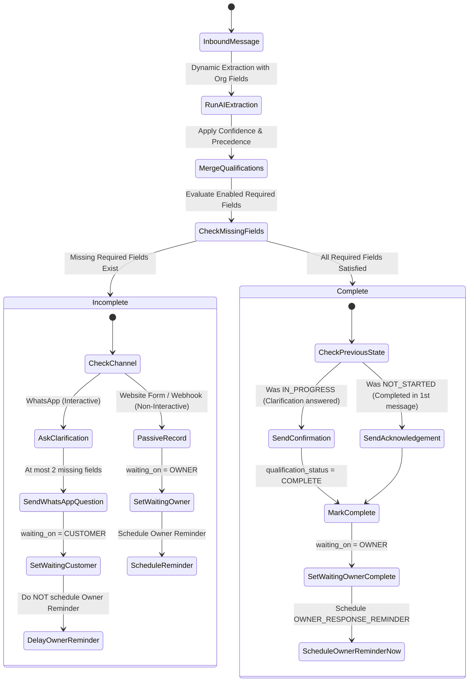

# Phase 3B — Generic Business Qualification Engine Architecture & Specification

## 1. Executive Summary

Missed Lead Rescue is a **general-purpose inbound lead qualification and recovery platform**. It serves diverse small and medium businesses—including clothing and apparel stores, dental clinics, real estate brokerages, HVAC/home services, salons, digital agencies, travel businesses, restaurants, and SaaS companies.

The goal of Phase 3B is to introduce a **generic, configurable qualification engine** that eliminates niche-specific code branches. Every organization can define:
1. What details it collects from customers (e.g., `product`, `size`, `service`, `preferred_date`, `budget`).
2. Which fields are required vs. optional.
3. How AI extracts these values dynamically across single or multi-turn conversations.
4. What clarification question is asked when required fields are missing.

---

## 2. Current Extraction Architecture Inspection

### 2.1 Existing AI Provider Architecture
- **Contract:** Defined in `app/ai/base.py` via `AIProvider(Protocol)` with method:
  ```python
  def extract_lead_information(self, message: str, *, business_type: str = "GENERAL") -> LeadExtractionResult
  ```
- **Result Schema (`app/schemas/ai.py`):** Fixed fields:
  `intent`, `category_or_service`, `urgency`, `location`, `preferred_date`, `preferred_time`, `product_name`, `product_variant`, `quantity`, `summary`, `confidence`, `additional_fields: dict`.
- **Implementations:**
  - `MockAIProvider` (`app/ai/mock.py`): Deterministic regex-based extractor matching common services, products, sizes, dates, quantities.
  - `OpenAIProvider` (`app/ai/openai_provider.py`): Uses OpenAI structured outputs parsing directly into `LeadExtractionResult`.

### 2.2 Existing Inbound & Lead Flow
- `InboundLeadService.process(...)` (`app/services/inbound.py`):
  1. Resolves/creates `Customer` via normalized phone/email.
  2. Stores `InboundMessage`.
  3. Calls `self.ai.extract_lead_information(message.message_text, business_type=...)`.
  4. Finds existing open `Lead` or creates a new one.
  5. Gets or creates `Conversation` (`channel=payload.channel`), records `ConversationMessage` (`INBOUND`).
  6. Schedules `OWNER_RESPONSE_REMINDER` immediately if `waiting_on == OWNER`.
  7. Invokes `_acknowledge(...)`, sending automated WhatsApp acknowledgement (`SYSTEM` message).

### 2.3 Limitations of Current System
- The extraction schema hardcodes fields like `product_name`, `service_type`, `location`.
- It cannot adapt when a real estate firm needs `property_type` and `budget`, or a clinic needs `insurance_provider`.
- Clarification questions are never asked: if a customer omits their size or preferred time, the owner must manually ask.
- The owner reminder immediately starts ticking even if the lead has not provided essential qualifying information.

---

## 3. Generic Field-Definition Model (`QualificationField`)

### 3.1 Database Entity
A new table `qualification_fields` represents an organization's qualification criteria:

```sql
CREATE TABLE qualification_fields (
    id UUID PRIMARY KEY,
    organization_id UUID NOT NULL REFERENCES organizations(id) ON DELETE CASCADE,
    key VARCHAR(64) NOT NULL,
    label VARCHAR(128) NOT NULL,
    description TEXT NULL,
    field_type VARCHAR(32) NOT NULL DEFAULT 'TEXT',
    required BOOLEAN NOT NULL DEFAULT TRUE,
    enabled BOOLEAN NOT NULL DEFAULT TRUE,
    sort_order INTEGER NOT NULL DEFAULT 0,
    question_text TEXT NULL,
    options JSONB NULL,
    example_values JSONB NULL,
    created_at TIMESTAMPTZ NOT NULL,
    updated_at TIMESTAMPTZ NOT NULL,
    CONSTRAINT uq_qualification_fields_org_key UNIQUE (organization_id, key)
);
CREATE INDEX ix_qualification_fields_org_order ON qualification_fields (organization_id, enabled, sort_order);
```

### 3.2 Key Rules & Validation
- `key`: lowercase letters, digits, and underscores only (`^[a-z0-9_]{2,64}$`).
- Unique per organization: `(organization_id, key)`.
- Disallowed reserved keys: `id`, `created_at`, `updated_at`, `organization_id`, `status`.

### 3.3 Field Types Supported
- `TEXT` (free-form string)
- `NUMBER` (integer or numeric amount)
- `BOOLEAN` (yes/no, true/false)
- `DATE` (calendar date)
- `DATETIME` (calendar date with time)
- `CHOICE` (single selection from `options`)
- `MULTI_CHOICE` (array of selections from `options`)
- `PHONE` (phone number)
- `EMAIL` (email address)
- `LOCATION` (city, address, zip code)

---

## 4. Starter Templates (Organizational Defaults)

Templates pre-populate default `QualificationField` records for an organization. Templates **never create separate code branches**; they only configure rows in `qualification_fields`.

| Template | Pre-Populated Fields | Required | Question Text Example |
| :--- | :--- | :--- | :--- |
| **CLOTHING** | `product`, `size`, `quantity`, `delivery_city` | All `True` | "What size do you need?", "Which city should we deliver to?" |
| **DENTAL** | `service`, `preferred_date`, `preferred_time` | All `True` | "What dental service are you looking for?", "What time works best for you?" |
| **REAL_ESTATE**| `intent`, `property_type`, `location`, `budget` | All `True` | "Are you looking to buy or rent?", "What budget range are you considering?" |
| **HOME_SERVICES**| `service_needed`, `issue_description`, `address_or_zip`, `urgency` | All `True` | "What service do you need?", "What is your address or zip code?" |
| **GENERAL** | `inquiry_type`, `details` | All `True` | "How can we help you today?", "Could you provide a few more details?" |
| **SALON** | `treatment`, `preferred_date`, `preferred_time` | All `True` | "Which treatment or styling service would you like?" |
| **AGENCY** | `project_type`, `budget`, `timeline` | `True` / `False` | "What type of project are you planning?", "What is your estimated budget?" |
| **RESTAURANT** | `party_size`, `reservation_date`, `reservation_time` | All `True` | "For how many guests?", "What date and time would you like to book?" |

Organizations can add custom fields, edit existing questions, change field order, or disable any field anytime.

---

## 5. Generic Qualification Storage on `Lead`

Instead of creating industry-specific columns on `Lead`, we add generic storage:
1. `leads.qualifications` (`JSONB`, default `{}`):
   ```json
   {
     "product": "black dress",
     "size": "medium",
     "quantity": 1,
     "delivery_city": "Lahore"
   }
   ```
2. `leads.qualification_status` (`Enum(QualificationStatus)`, default `'NOT_STARTED'`):
   - `NOT_STARTED`: No qualification fields defined or extraction hasn't evaluated yet.
   - `IN_PROGRESS`: Some required fields are still missing.
   - `COMPLETE`: All enabled required fields are satisfied.
3. `leads.qualification_completed_at` (`DateTime(timezone=True)`, nullable): Timestamp when the last required field was resolved.
4. `leads.qualification_metadata` (`JSONB`, default `{}`): Tracks question state (e.g. `last_question_fields`, `prompt_count`, `field_confidences`) to prevent question loops.

---

## 6. AI Extraction & Contract

### 6.1 Dynamic Extraction Contract
Refactor `AIProvider.extract_lead_information` to accept field definitions and current state:

```python
class QualificationFieldDefinition(BaseModel):
    key: str
    label: str
    field_type: str
    description: str | None = None
    required: bool = True
    options: list[str] | None = None

class DynamicExtractionResult(BaseModel):
    summary: str
    intent: str | None = None
    urgency: Urgency = Urgency.NORMAL
    extracted_fields: dict[str, Any] = Field(default_factory=dict)
    field_confidences: dict[str, float] = Field(default_factory=dict)
    overall_confidence: float = 1.0
```

### 6.2 Backwards Compatibility
Existing fields on `Lead` (`intent`, `category_or_service`, `product_name`, `product_variant`, `quantity`, `location`, `preferred_date`, `preferred_time`) remain mapped from `extracted_fields` for search and dashboard compatibility when keys match standard names.

### 6.3 Confidence Handling & Merge Rules
- Configurable threshold: `QUALIFICATION_MIN_CONFIDENCE=0.65`.
- If extracted field confidence < threshold, it is treated as unextracted (missing).
- **Data Precedence:**
  - A newly extracted non-empty value overrides an older value only if confidence >= threshold.
  - A `null` or empty extraction from subsequent messages **never** erases a previously confirmed value.
  - Customer explicit corrections (e.g., "Actually, make that large") update the field.

---

## 7. Multi-Turn Qualification Flow & State Machine



### 7.1 Response Behavior Matrix

| Scenario | Qualification Status | WhatsApp Response | `waiting_on` | Owner Reminder Scheduled? |
| :--- | :--- | :--- | :--- | :--- |
| **First message, all required provided** | `COMPLETE` | Standard acknowledgement greeting | `OWNER` | **YES** (after standard delay) |
| **First message, missing fields** | `IN_PROGRESS` | Clarification question (max 2 fields) | `CUSTOMER` | **NO** (waits for customer) |
| **Customer answers, still missing fields** | `IN_PROGRESS` | Next clarification question | `CUSTOMER` | **NO** |
| **Customer answers, all required satisfied**| `COMPLETE` | "Thanks, I've got the details! Someone from the team will get back to you shortly." | `OWNER` | **YES** |
| **Website form / webhook (missing fields)**| `IN_PROGRESS` | Standard email acknowledgement (no interactive chat) | `OWNER` | **YES** |

---

## 8. Clarification Question Generation Strategy

### 8.1 Question Selection
- `QualificationQuestionService.generate_question(missing_fields)`
- Selects the first 1 or 2 missing required fields based on `sort_order`.
- Max 2 fields per message prevents overwhelming the customer.

### 8.2 Deterministic Construction
1. If the field has a customized `question_text`, use it directly.
2. Otherwise, construct a natural fallback based on `field_type` and `label`:
   - `CHOICE`: "Which {label} would you prefer? Options: {options}."
   - `DATE` / `DATETIME`: "What {label} works best for you?"
   - `LOCATION`: "What {label} should we use?"
   - `NUMBER`: "How many {label} do you need?"
   - Default: "Could you please provide your {label}?"
3. If two fields are asked together:
   Combine naturally: `"Could you please let us know: {question_1} Also, {question_2}"`

---

## 9. Security, Isolation & Safety

1. **Multi-Tenancy:** `QualificationField` operations are strictly scoped to `organization_id`. Field keys are sanitized.
2. **Untrusted AI Output Validation:** Extracted fields are strictly filtered against the organization's registered keys. AI cannot invent new database columns or mutate schemas.
3. **Loop Prevention:** Metadata tracks `prompt_count` for each field. If a customer sends 3 messages without answering a required field, the system avoids infinite repetitive questioning and transfers `waiting_on=OWNER`.
4. **Idempotent Webhooks:** Meta delivery retries check `organization_id + channel + external_message_id`. Duplicate payloads exit before question generation or message dispatch.

---

## 10. Limitations & Next-Phase Readiness

### 10.1 Current Scope & Boundaries
- Multi-turn interactive qualification is enabled for `WHATSAPP`. Inbound forms and webhooks record qualification state and evaluate completion, but do not conduct interactive chat.
- Search indexing across arbitrary JSON `qualifications` keys is deferred; canonical lead fields (`product_name`, `category_or_service`, `location`) remain indexed for high-performance search.
- Question generation is deterministic and template-based to control cost, maintain predictability, and prevent hallucination loops.

### 10.2 Next-Phase Readiness (Phase 3C / 4)
- Foundation is completely general-purpose: zero industry-specific database columns or branch logic.
- Ready for customer follow-up cadences, automated appointment bookings, or payment collection integrations.

